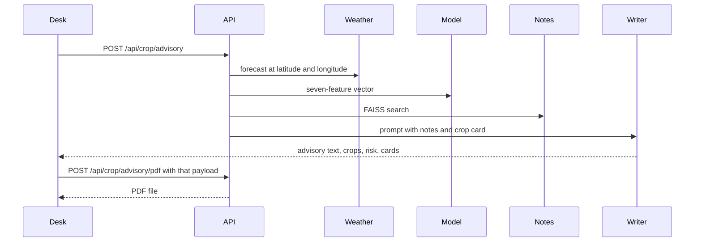

# KRISHI AI: A Smart Crop Advisory System

Final Project Report

Capstone Project 1 (BCSE0758 / BCSEH0758)

Dr. A.P.J. Abdul Kalam Technical University, Lucknow

Noida Institute of Engineering and Technology, Greater Noida

Department of Computer Science and Engineering

2026

---

## Title page

**Project title:** KRISHI AI: A Smart Crop Advisory System

**Team:**

- Harshit Kumar, Team Lead, 2301330100093
- Harsh Sharma, 2301330100092
- Bharat Singhal, 2301330100071
- Kunal Bansal, 2301330100106

**Programme:** B.Tech, Computer Science and Engineering, Section B

**Supervisor:** Prof. (Dr.) Rahul Kumar Sharma, Department of Computer Science and Engineering, NIET Greater Noida

**Affiliation:** Dr. A.P.J. Abdul Kalam Technical University, Lucknow

This report covers one project at two milestones. Milestone 1 built the crop model, weather link, accounts, and the first advisory screen. Milestone 2, building on that foundation, adds place search for any coordinate, nearest-district context, retrieval-grounded writing, and a dashboard the farmer can carry as a PDF.

---

## Declaration

The team declares that this report, titled "KRISHI AI: A Smart Crop Advisory System", is the team's own account of work carried out for Capstone Project 1 at NIET Greater Noida under Dr. A.P.J. Abdul Kalam Technical University, Lucknow. Sources are listed in the References. Figures that were finalized earlier in the synopsis and the capstone presentation are marked for insertion. Figures drawn from the running code are identified as such. No result in this report is claimed for a module that the demonstration cannot show.

---

## Certificate

This is to certify that the project entitled "KRISHI AI: A Smart Crop Advisory System" is a record of work carried out by Harshit Kumar (2301330100093), Harsh Sharma (2301330100092), Bharat Singhal (2301330100071), and Kunal Bansal (2301330100106), students of B.Tech Computer Science and Engineering, under the supervision of Prof. (Dr.) Rahul Kumar Sharma, Department of Computer Science and Engineering, Noida Institute of Engineering and Technology, Greater Noida.

The report is submitted toward the requirements of Capstone Project 1 (BCSE0758 / BCSEH0758).

Supervisor: Prof. (Dr.) Rahul Kumar Sharma

Head of Department: (signature block to be completed on the printed copy)

---

## Acknowledgement

The team thanks Prof. (Dr.) Rahul Kumar Sharma for supervision and for insisting that the practical path of the system be stated plainly. The team also thanks the Department of Computer Science and Engineering, NIET Greater Noida, and Dr. A.P.J. Abdul Kalam Technical University, Lucknow, for the capstone framework. Public technical material from the Food and Agriculture Organization, the Government of India's Soil Health Card programme, OpenWeather, and the published machine-learning literature listed in the References informed the design. Any error in the description of the running system is the team's.

---

## Abstract

KRISHI AI is a software advisory system that helps a farmer, or an operator sitting with a farmer, choose a crop from soil nutrients, weather, and a short written plan. Milestone 1 trained and saved a scikit-learn Random Forest on the public crop-recommendation table (nitrogen, phosphorus, potassium, temperature, humidity, pH, and rainfall) and exposed it through a Flask API, a Streamlit screen, MongoDB Atlas accounts, and the OpenWeather service. Milestone 2 builds on that foundation. It does not replace the model. It lets the farmer use any place: a map click, a typed name, the device location, or a spoken name. The API geocodes the place, reads weather at those coordinates, and attaches the nearest district profile when the point is not one of the original sample cities. Soil values from a test are used when the farmer enters them. Otherwise the district profile is used and labeled as an estimate. A LangGraph path then checks risk, retrieves agronomy notes from a local FAISS index, and asks a language model to write the advisory in English or Hindi, using only those notes and the measured inputs. The same text is spoken and saved as a PDF. The project does not claim a camera model for pests, a live mandi feed, or sensors in the field. Those items remain future work. The deliverable is the running web application and the PDF a farmer can carry.

---

## Table of contents

1. Introduction
2. Literature review
3. Requirements and analysis
4. Proposed methodology
5. Results
6. Practical deployment and real-world feasibility
7. Conclusion and future work
8. References
9. Appendices
10. Publications, snapshots, plagiarism report, and curriculum vitae

---

## List of tables

- Table 2.1 Comparative study of existing agricultural information systems
- Table 3.1 Functional and non-functional requirements
- Table 3.2 Software and hardware used, including the Milestone 2 layer
- Table 3.3 Planning blocks, including the agentic integration sprint
- Table 5.1 Inputs accepted by the saved crop model
- Table 5.2 Fit of the saved model on its training table

---

## List of figures

- Fig. 4.1 System architecture, with the agentic layer between the model and the farmer
- Fig. 4.2 Use case diagram (insert the finalized synopsis figure)
- Fig. 4.3 ER diagram (insert the finalized synopsis figure)
- Fig. 4.4 DFD Level 0 (insert the finalized synopsis figure)
- Fig. 4.5 DFD Level 1 (insert the finalized synopsis figure)
- Fig. 4.6 System flowchart (insert the finalized synopsis figure)
- Fig. 4.7 Class view of the running advisory path
- Fig. 4.8 Sequence of one advisory request
- Fig. 5.1 Advisory desk (capture from the running Streamlit application at evaluation)

---

## List of abbreviations

- API: Application Programming Interface
- CACP: Commission for Agricultural Costs and Prices
- CSC: Common Service Centre
- FAISS: Facebook AI Similarity Search
- JWT: JSON Web Token
- KVK: Krishi Vigyan Kendra
- LLM: Large Language Model
- ML: Machine Learning
- MSP: Minimum Support Price
- NPK: Nitrogen, Phosphorus, and Potassium
- PDF: Portable Document Format
- RAG: Retrieval-Augmented Generation

---

# Chapter 1. Introduction

## 1.1 Background

### Overview of agricultural challenges in India

A large share of Indian holdings are small. The sowing decision still depends on the monsoon window, the last soil test the farmer can obtain, the price expected at the nearest market, and advice from a dealer or a neighbour. Those sources are useful. They are also uneven. A dealer may stock one fertilizer. A neighbour's field may not share the same pH. A weather application may show rain and stop there. The gap is not a lack of data in the country. It is that soil numbers, the coming week's weather, and a written reason for a crop rarely sit on one page the farmer can take to a shop or a bank.

### Role of technology in smart farming

Digital tools already reach many villages through weather alerts, market tickers, and government portals. Their value in this project is narrow and practical: turn numbers a farmer already has, or can get once in a season, into a recommendation that states its limits. The system is decision support. It is not a claim that software replaces the local extension worker.

### Machine learning in agriculture

Supervised classifiers can map a vector of soil and weather features to a crop label when a labeled table exists. The table used here is the widely circulated crop-recommendation set of 22 crops and seven numeric features. A Random Forest was fit on that table in Milestone 1 and saved. Milestone 2 does not pretend the forest knows a village it was never shown. Location enters as weather at the farmer's coordinates and as a nearest-district note beside the prediction.

### Image processing for pest detection

Leaf photography is a known research line, and convolutional models have been published for plant-disease image sets (Ferentinos, 2018; Kamilaris and Prenafeta-Boldu, 2018). This codebase does not contain such a model, and this report does not invent an accuracy for one. What the running system does provide is a written scouting answer: the farmer describes a symptom, retrieval returns the pest note, and the language model answers from that note. A trained image detector remains future work, stated again in Chapter 7.

### Real-time weather data integration

Temperature, humidity, and a short rain forecast are read from the OpenWeather service at the farmer's latitude and longitude each time an advisory is requested. The farmer does not type the weather. The rainfall value passed into the saved model is a 90-day proxy built from the next five forecast days, because the model was trained on seasonal rainfall figures, not on a single afternoon. The screen and the PDF say so.

## 1.2 Identified issues and research gaps

1. Public tools split the decision. Weather, soil-health cards, and crop lists live in different places.
2. Many student systems accept only a fixed list of cities, so a village that is not on the list is silently moved to a distant city.
3. A classifier score, shown alone, does not tell a farmer what to watch for, what the yield band usually is, or which note justified the fertilizer remark.
4. Soil nutrient tests are periodic, not hourly. Systems that imply continuous soil sensing overclaim what a software project can do.
5. Advice that a language model writes with no retrieved source is difficult to defend in front of a farmer or an examiner.

Milestone 2 is the project's answer to items 2, 3, and 5, built on the Milestone 1 model rather than beside it. Item 4 is handled by an honest data story in Chapter 6, not by a sensor claim.

## 1.3 Objective and scope

The objective is a demonstrable advisory desk that:

- authenticates a user and stores a short history,
- accepts any place by map, text, device location, or speech,
- reads live weather for that place,
- runs the saved crop model on soil nutrients and that weather,
- says when the soil numbers or the district match are estimates,
- writes a grounded advisory in English or Hindi, with audio and a PDF,
- records a farm profile and shows earlier runs.

The scope is a web application on a laptop or a small cloud host. It is not a mobile-store application, not an IoT installation, and not a market-trading system. Indicative price notes cite a published MSP schedule where one exists. They are not today's mandi rate.

## 1.4 Project report organization

Chapter 2 reviews traditional practice and existing digital systems. Chapter 3 states requirements and the two planning blocks. Chapter 4 describes the method, including the LangGraph and retrieval module. Chapter 5 reports what the running system produces. Chapter 6 answers how a farmer actually supplies data and what physical thing an evaluator can hold. Chapter 7 closes the objectives and lists work that is still undone.

---

# Chapter 2. Literature review

## 2.1 Analysis of traditional farming methods

Sowing dates, variety choice, and fertilizer rates in much of India are still set by season (kharif and rabi), by what the previous crop left in the soil, and by what the local buyer will take. Soil testing under the Soil Health Card programme already exists as a periodic public service, not as a daily measurement. Extension workers at Krishi Vigyan Kendras and input dealers remain the people a farmer can question. Any software that ignores that path will not be used. KRISHI AI is specified as a second opinion inside that path.

## 2.2 Review of existing agricultural systems

Government portals publish schemes, soil-health guidance, and, in season, minimum support prices. Weather applications publish rain and temperature and stop. Agri mobile applications such as Kisan Suvidha and IFFCO Kisan already show that village reach often goes through a phone, a kiosk, or an input dealer, not only through a farmer operating a complex form alone. Research reviews (Liakos et al., 2018; Wolfert et al., 2017) describe machine learning and data platforms for yield, disease, and farm management, and they also describe the gap between a model score and a decision a farmer will trust. Retrieval-augmented generation (Lewis et al., 2020) is the method this project uses to keep written advice tied to a local note set instead of an unsupported paragraph.

## 2.3 Comparative study of existing systems

Table 2.1. Comparative study of existing agricultural information systems

| System | What the user gets | What is missing for this problem |
|---|---|---|
| Soil Health Card and district soil labs | Periodic N, P, K, and pH for a holding | No crop rank for today's weather, no written plan |
| Public weather applications | Temperature, humidity, rain at a place | No soil link and no crop model |
| Kisan Suvidha and similar government apps | Schemes, weather, and some advisories at national scale | Not a project-owned model the team can open and explain |
| Input dealer and KVK advice | Local judgement and products on the shelf | Not repeatable, and the incentive is not always neutral |
| KRISHI AI (this project) | Crop rank from the saved model, live weather at the chosen point, nearest-district context, retrieved notes, PDF | No in-field sensors, no photo disease model, no live mandi tape |

The last row is the scope of the demonstration. It is not a claim that the project replaces the other rows.

---

# Chapter 3. Requirements and analysis

## 3.1 Requirements specification

Table 3.1. Requirements

| ID | Type | Requirement | Where it is met |
|---|---|---|---|
| F1 | Functional | Register and sign in, with a token on later calls | `/api/auth`, JWT |
| F2 | Functional | Choose any place by map click, typed name, device location, or speech | Advisory desk and `/api/location/resolve` |
| F3 | Functional | Read current weather and a short forecast at that coordinate | OpenWeather in `weather_service` |
| F4 | Functional | Accept N, P, K, and pH, or fill them from the nearest district and label the estimate | Crop controller and the soil panel |
| F5 | Functional | Rank crops with the saved Random Forest | `crop_model.pkl` |
| F6 | Functional | Attach fertilizer, yield band, challenges, and a price note | Crop cards and fertilizer service |
| F7 | Functional | Retrieve agronomy notes and write the advisory in English or Hindi | LangGraph, FAISS, Groq |
| F8 | Functional | Speak that advisory and download the same text as a PDF | gTTS on the desk, fpdf2 on the API |
| F9 | Functional | Answer a follow-up, including a described symptom, without a new photo model | `/api/crop/ask` |
| F10 | Functional | Save a farm and list past advisories | `/api/farm`, `/api/history` |
| N1 | Non-functional | Do not present an estimate as a soil test | `soil_source` and the on-screen basis line |
| N2 | Non-functional | Reject N, P, and K outside 0 to 150, and pH outside 0 to 14 | `validation.py` |
| N3 | Non-functional | Run the model on CPU. Do not require a GPU | CPU PyTorch wheel, scikit-learn 1.6.1 |
| N4 | Non-functional | Keep secrets in `backend/.env`, not in source | Weather and JWT read the environment |
| N5 | Non-functional | State price figures as references, not as live mandi rates | Crop cards and the PDF |

## 3.2 Planning and scheduling

The synopsis Gantt chart is inserted here on the printed copy. It is not redrawn. Two blocks are explicit:

Table 3.3. Planning blocks

| Block | Intent | Outcome in this report |
|---|---|---|
| Milestone 1 | Model, accounts, weather-by-city, first Streamlit flow | Saved Random Forest, Flask, MongoDB, OpenWeather |
| Milestone 2, Agentic AI Integration Sprint | Any-place weather, nearest profile, retrieval, written advisory, dashboard, PDF | The running desk described in Chapters 4 to 6 |

Milestone 2 is a sprint on the same system. It is not a second project.

## 3.3 Software and hardware requirements

Table 3.2. Software and hardware

| Layer | Milestone 1 | Added for Milestone 2 |
|---|---|---|
| Language | Python 3.11 to 3.13 | Same. Python 3.14 and newer are not used |
| API | Flask, Flask-CORS | Location resolve route, ask route |
| Screen | Streamlit, Folium | Dark dashboard, Plotly charts, device location |
| Data | MongoDB Atlas | Local district gazetteer and crop cards as fallback context |
| Model | scikit-learn 1.6.1 Random Forest, joblib | Unchanged pickle |
| Weather | OpenWeather current weather | Geocoding, coordinate weather, five-day forecast |
| Auth | JWT, bcrypt | Secret taken from the environment |
| Reasoning | Not in Milestone 1 | LangGraph graph: predict, risk, retrieve, write |
| Retrieval | Not in Milestone 1 | sentence-transformers, FAISS, nine local notes |
| Language model | Not in Milestone 1 | Groq through langchain-groq |
| Document | Not in Milestone 1 | fpdf2, DejaVu and Noto fonts bundled for English and Hindi |
| Hardware | Laptop, browser, internet | Microphone optional. No GPU required |

## 3.4 Preliminary product description

The product a stakeholder opens is a browser page on port 8501 talking to an API on port 5001. After sign-in the page is a desk: a place panel, a soil panel, the advisory, a farm list, and a history list. The object a farmer can carry out of the room is the PDF. Chapter 6 states this directly so the evaluation is not waiting for a hardware box.

---

# Chapter 4. Proposed methodology

## 4.1 System architecture overview

The farmer uses the Streamlit desk. The desk calls the Flask API. The API resolves the place, reads weather at the coordinate, selects the nearest district profile, builds the seven-feature vector, and runs the saved forest. That result enters a LangGraph state. One node checks risk, including distance and whether the soil values were estimated. The next node retrieves notes. The last node writes the advisory, with the warning included when risk was flagged. The desk draws cards and charts from that JSON and can request the PDF of the same payload.

Fig. 4.1. Architecture (render for the printed copy)

```mermaid
flowchart LR
  farmer[FarmerOrOperator] --> desk[StreamlitDesk]
  desk --> api[FlaskAPI]
  api --> geo[GeocodeAndForecast]
  api --> near[NearestDistrict]
  geo --> model[RandomForest]
  near --> model
  model --> graph[LangGraph]
  graph --> faiss[FAISSNotes]
  graph --> writer[GroqAdvisory]
  writer --> pdf[PDFAndAudio]
```

The agentic block sits between the model and the page the farmer reads. It does not replace the forest.

## 4.2 Module description

### 4.2.1 Data collection and preprocessing

The crop table has 2,200 rows, 100 for each of 22 labels, and the columns N, P, K, temperature, humidity, pH, rainfall, and label. Milestone 1 fit the forest on this table. No new labeled rows were added. Two reference files were added and are not training data:

- A gazetteer of 400 district and town profiles with coordinates, state, zone, a typical soil texture, planning values for N, P, K, and pH, and crops commonly grown nearby. Nutrient figures in that file are planning estimates. The screen says so. The larger list is only so an unfamiliar village falls closer to a known profile. It is not a new training set.
- A crop card for each of the 22 labels: a yield band, a season, challenges, states where the crop is commonly grown, the mean feature vector of that label in the training table, and an MSP note where the 2024-25 CACP schedule has one.

Live inputs at request time are the coordinate weather and the soil numbers, either typed or taken from the nearest gazetteer row.

### 4.2.2 Machine learning prediction engine

`crop_service.py` loads `backend/models/crop_model.pkl` once and calls `predict_proba`. The vector is one row with the seven training columns. The service returns the three labels with the highest probability. Potassium and the other nutrients are limited to the range 0 to 150 by the API. The training rows for apple and grape often sit above 150 for potassium, so those classes are less reachable from the form. That limit is documented rather than silently widened.

Rainfall in the vector is not the raw five-day millimetre total. A five-day total is on a different scale from the training column, which sits roughly between 25 mm and 240 mm depending on the crop. The service therefore uses a seasonal proxy: average daily forecast rain multiplied by 90. The proxy is named on the screen and in the PDF. It is not described as a full monsoon total.

### 4.2.3 Recommendation algorithm

After the forest returns three crops, the controller adjusts confidence slightly. A crop that appears in the nearest district's common-crop list is nudged up. A crop that appears only in the coarse regional fertilizer table is nudged less. A crop in neither list is nudged down and marked as outside the nearby trend. The forest's label is not replaced by a hard-coded regional crop. Earlier code could substitute a regional name at a fixed confidence when the filter removed every model label. That substitution is removed, because it hid the model on places the list did not know.

The fertilizer note still comes from the regional NPK table, now pointed at the same nearest district the gazetteer chose, so the zone and the profile do not disagree.

### 4.2.4 LangGraph agentic reasoning and RAG knowledge module

The graph is defined in `backend/services/agentic_service.py`. The state carries the farmer input, the recommendation, risk flags, retrieved notes, and the advisory text. The edges are fixed in order, and the writing node is chosen by whether any risk flag was raised:

1. `predict_crop` calls the Milestone 1 controller.
2. `check_risk` flags low confidence, extreme temperature or humidity, a seasonal-rainfall proxy outside 20 mm to 300 mm, pH outside 5.5 to 8.5, low nutrients, a distant district match, and estimated soil.
3. `retrieve_knowledge` embeds the crop, the nutrients, and the risk text with `all-MiniLM-L6-v2` and searches a FAISS inner-product index.
4. The writing node calls Groq. The prompt requires the selected language, forbids invented rates and invented mandi prices, and pastes the retrieved notes and the crop card. If the language model is unavailable, the API returns a short automatic summary that says so, and the crop list is still present.

The index is built from the text files in `rag_standalone/knowledge/` (nutrients, pH, irrigation, pest scouting, fertilizer timing, organic matter, rotation, sowing rain, and whole-field diagnosis). There is no second copy of those notes inside the service. A follow-up question uses the same index and does not rerun the forest.

This is the retrieval pattern of Lewis et al. (2020) applied to a small, inspected note set: the model may phrase the answer, and the notes that were retrieved are shown on the desk.

### 4.2.5 Advisory report generation and dark-mode dashboard

The desk is one Streamlit application, split into a theme, a translation table for English and Hindi chrome, and an API client. It is not a second frontend framework. The page uses a dark field, glass-style panels, a free-click map on a dark tile set, metric cards, a risk gauge, and Plotly charts for confidence, yield bands, and forecast rain. Those charts read the API payload. They do not read a table baked into the page.

The PDF is produced by fpdf2 from the advisory already on screen, so the file matches the paragraph the farmer just read. English uses the bundled DejaVu font. Hindi uses the bundled Noto Sans Devanagari font. Audio is synthesized from that same paragraph and played in the browser. It is not a stored clip of a single crop name.

## 4.3 UML design

The use case diagram, the ER diagram, DFD Level 0, DFD Level 1, and the system flowchart were finalized in the synopsis and the capstone presentation. They are inserted on the printed copy as Fig. 4.2 through Fig. 4.6. They are not redrawn here, and they are not replaced with invented variants.

Fig. 4.7 is the class view of the code that actually runs. The responsibilities are:

- `weather_service`: geocode, reverse geocode, current weather, forecast, seasonal proxy
- `location_service`: haversine search over the gazetteer
- `crop_controller`: validate, assemble the vector, call the forest, attach cards
- `crop_service`: load the pickle and return three probabilities
- `rag_service`: load the nine notes and search FAISS
- `agentic_service`: the graph, the writer, and the PDF
- The desk: calls only the HTTP routes

Fig. 4.8 is the sequence of one advisory. The desk sends the place, the soil source, and the nutrients with a bearer token. The API resolves weather and the nearest district, runs the forest, runs the graph, and returns JSON. A later PDF request sends that JSON back and does not call the language model a second time.



---

# Chapter 5. Results

## 5.1 Data processing and input handling

A request without a place name is rejected. A request with a name and no coordinates is geocoded. A request with coordinates is reverse-geocoded so the PDF can name the point. N, P, and K outside 0 to 150, and pH outside 0 to 14, are rejected before the model runs. If the farmer marks the nutrients as an estimate, or leaves any of them empty, the nearest district profile supplies the missing values and `soil_source` is recorded. History stores the place, the soil source, the vector, and the nearest district. If MongoDB is unreachable, the advisory can still be computed from the gazetteer and the weather call, and the history write is skipped rather than failing the recommendation. Sign-in itself still requires the database.

## 5.2 Model output and prediction results

The saved model is a scikit-learn 1.6.1 Random Forest. The dependency is pinned to that version so the pickle loads without a version mismatch. Scored on the same 2,200-row table it was trained from, its resubstitution accuracy is reported in Table 5.2. That figure is a fit check. It is not an independent field trial and it is not an accuracy on villages the table never labeled.

Table 5.1. Inputs accepted by the saved crop model

| Feature | Source at request time | Unit in the training table |
|---|---|---|
| N, P, K | Farmer's test, or nearest-district estimate | Dataset units, clipped to 0-150 |
| temperature, humidity | OpenWeather at the coordinate | degrees C, percent |
| pH | Farmer's test, or nearest-district estimate | pH |
| rainfall | 90-day proxy from the five-day forecast | mm, seasonal scale |

Table 5.2. Fit of the saved model on its training table

| Check | Value |
|---|---|
| Rows | 2200 |
| Labels | 22, 100 rows each |
| Resubstitution accuracy | 99.86 percent (2,200 training rows, 22 labels). Fit check only. |

The three returned crops keep their probability, after the small nearby-trend adjustment in Section 4.2.3. The desk shows that adjusted confidence and the fit tag (`nearby`, `region`, or `outside_nearby_trend`).

## 5.3 Pest and symptom guidance

There is no image classifier in the repository, so this section does not show a confusion matrix. The pest note in the knowledge folder describes scouting signs: holes, mines, honeydew, webbing, and the warning that yellowing alone is not proof of insects. When the farmer types a symptom in the follow-up box, retrieval is biased toward that note by the question text, and the written answer must stay inside the retrieved material. The team can demonstrate this path live. The team cannot demonstrate a camera diagnosis, and the report does not claim one.

## 5.4 Agentic advisory output

A completed response contains the recommended crop, the top three, the weather object (including the five-day rain total and the seasonal proxy), the soil source, the nearest district and distance in kilometres, the crop cards, the retrieved note texts, the risk flags, and `advisory_text`. The PDF repeats the place, the distance, the soil source, the yield band, the price disclaimer, and the advisory. A sample for the printed report should be captured from a live run during evaluation (one English advisory and, if time allows, one Hindi advisory). The text will differ from run to run because it is generated for that place and those numbers. That variation is intended. A fixed sentence is not.

## 5.5 User interface demonstration

Fig. 5.1 is a capture of the running desk, taken at evaluation and pasted into the printed binding. The capture should show the place card (selected name, nearest district, kilometres, current weather), the soil panel with the estimate label, and the advisory cards. The Milestone 1 screen was a single Streamlit script with a short location list. The Milestone 2 desk keeps Streamlit and replaces that list with the flow in Section 4.2.5. Both are the same application at two stages, not two products.

## 5.6 Performance analysis

Two different measurements are relevant, and they must not be mixed.

1. Model fit. Scored with scikit-learn 1.6.1 on the same 2,200-row table used to train it, the saved forest labels 99.86 percent of those rows correctly. A high value is expected when a forest is scored on rows it has already seen. It does not measure performance on a new district. Table 5.2 records this as a fit check.
2. Request time. Geocoding, the forecast, the embedding model (first call downloads it), and the language model are network calls. The forest itself is a local pickle and is not the slow part. The desk warns that the first advisory can take about a minute while the note index is cached.

Nearest-district search is an in-memory haversine over 108 points. It is not a scalability bottleneck at demonstration size. Scaling the note index or the user base is listed as future work, not as a measured production capacity.

---

# Chapter 6. Practical deployment and real-world feasibility

This chapter answers a direct review question: how the system gets fresh data, how a farmer who is not comfortable with a form actually uses it, and what physical thing exists at the end, given that the project is software.

## 6.1 How data actually reaches the system

Weather is already handled, and the farmer does not maintain it. Each advisory calls OpenWeather with the latitude and longitude just chosen. Temperature, humidity, condition, and the next five forecast days are stored on that response. There is no separate weather-entry step.

Soil nutrients do not need to be "daily". Nitrogen, phosphorus, potassium, and pH change over a season, not over an afternoon, except after a fertilizer application or a flood. In India the periodic path already exists:

- The Soil Health Card Scheme of the Government of India tests and reissues a soil report for a farmer on a cycle of about two years, through the local agriculture department, at no charge to the farmer.
- District Krishi Vigyan Kendras and soil testing laboratories offer an on-demand test for a nominal fee.
- Commercial soil kits and strips, commonly sold in the range of a few hundred rupees, give an NPK and pH reading in minutes when a laboratory visit is impractical.

The data-entry story used by this project is the ordinary one. The farmer, or an operator helping the farmer, types the latest soil-test values once in a season. The application's job is to turn numbers the farmer already has, or can get cheaply, into a recommendation and a written plan. If those numbers are not at hand, the desk fills a district estimate and labels it. The operator can see the label before trusting the rank.

IoT probes that would stream soil values without this step are future work. Chapter 7 lists them. This chapter does not claim them.

## 6.2 How a farmer with low literacy or no smartphone uses this

Two features already on the desk reduce typing. Speech input accepts a place name. The map accepts a click, including a click made by an operator while the farmer points at a village. The written advisory can be played aloud in Hindi or English.

The rollout assumed here is the assisted-use model that already carries most public digital services into villages. The primary user on day one is not required to be a farmer alone with a personal smartphone.

- Common Service Centres already host operators for identity, banking, and certificates. The same operator can run KRISHI AI on the farmer's behalf and print the PDF.
- Krishi Vigyan Kendra staff and local input dealers already sit with farmers. They can use the desk as a second opinion during that conversation.
- A farmer who does have a phone can open the same URL. Hindi chrome and spoken output cover part of the reading load. The advisory itself is generated in the selected language, so the paragraph is not a fixed English sentence passed through a translator after the fact.

Kisan Suvidha and IFFCO Kisan are precedents for this distribution, not decorations. The project is using a channel that already exists.

## 6.3 What the physical product actually is

The deliverable is software: a web application and an API, reachable in a browser on a phone or a computer. At an evaluation the stakeholder can hold three things, and only these three:

1. The live application URL, operated in the room.
2. The PDF advisory for the farmer just entered. It is a file the farmer can take to an input dealer or attach to a conversation about credit. It states the crop, the place, the distance to the nearest profile, whether the soil numbers were a test or an estimate, the yield band, the price disclaimer, and the written plan.
3. Optionally, the same PDF printed as a one-page sheet. The backend already produces that file. Lamination is a printing step, not a separate system.

This is the normal product of a software capstone. There is no device to unbox. The demonstration is the working system and the document it writes.

## 6.4 Why a farmer would trust this beside a dealer or a neighbour

The retrieval step exists so the written lines can be tied to a note the team can open. The desk shows the note titles that were retrieved. A dealer may still be the person who sells the fertilizer. The system is not in that sale. The framing used in the prompt, and in this report, is a second opinion used with local knowledge. It is not a claim that the model should overrule a KVK scientist or a neighbour who knows the field.

Trust also depends on the labels in Chapter 5. An estimate that is called an estimate is easier to defend than a precise rank with a hidden city substitution. The distance in kilometres is on the page for that reason.

---

# Chapter 7. Conclusion and future work

## 7.1 Conclusion

The objectives in Section 1.3 are met on the running build, with the limits stated beside them.

- Milestone 1 accounts, the saved forest, weather, and a browser desk are in place.
- Building on that foundation, Milestone 2 accepts a place that was not on the original list, reads weather at that coordinate, and explains the nearest district when the point is unfamiliar.
- Risk checks, a local note index, and a language model produce a written advisory in the selected language. The same text is spoken and saved as a PDF.
- Soil values are either the farmer's test or a labeled estimate. The report does not describe sensors the team cannot point to.
- Price notes are references. Yield bands are indicative ranges from the crop cards, not a promise of a harvest.

The practical question in Chapter 6 has a concrete answer: weather is fetched, soil is entered once a season from a test the farmer can already obtain, an operator can run the desk, and the object that leaves the room is the PDF.

## 7.2 Limitations and future enhancements

The following are not done, and they are not described elsewhere as done:

- In-field IoT soil sensors and automatic nutrient streams
- A deep-learning detector on leaf photographs
- A mobile-store application
- Chrome and speech for languages beyond English and Hindi
- A live mandi or Agmarknet price tape, and a trained price forecast
- Integration with a specific government scheme portal
- Hosting, backups, and capacity beyond a single demonstration machine

Retrieval over nine curated notes is a controlled student index. It is not a national agronomy library. The seasonal rainfall proxy can misread a dry week inside an otherwise normal monsoon, which is why the screen names the proxy. The nutrient form cannot express the very high potassium rows associated with apple and grape in the training table. Those are limits of this build, not items already solved by the language-model layer.

---

# References

1. Breiman, L. (2001). Random forests. *Machine Learning*, 45(1), 5-32.
2. Ferentinos, K. P. (2018). Deep learning models for plant disease detection and diagnosis. *Computers and Electronics in Agriculture*, 145, 311-318.
3. Food and Agriculture Organization of the United Nations. (2017). *The future of food and agriculture: Trends and challenges*. Rome: FAO.
4. Goodfellow, I., Bengio, Y., and Courville, A. (2016). *Deep Learning*. Cambridge, MA: MIT Press.
5. Government of India, Ministry of Agriculture and Farmers Welfare. Soil Health Card scheme. https://soilhealth.dac.gov.in/
6. Kamilaris, A., and Prenafeta-Boldu, F. X. (2018). Deep learning in agriculture: A survey. *Computers and Electronics in Agriculture*, 147, 70-90.
7. Lewis, P., Perez, E., Piktus, A., Petroni, F., Karpukhin, V., Goyal, N., Kuttler, H., Lewis, M., Yih, W., Rocktaschel, T., Riedel, S., and Kiela, D. (2020). Retrieval-augmented generation for knowledge-intensive NLP tasks. *Advances in Neural Information Processing Systems*, 33.
8. Liakos, K. G., Busato, P., Moshou, D., Pearson, S., and Bochtis, D. (2018). Machine learning in agriculture: A review. *Sensors*, 18(8), 2674.
9. OpenWeather. Current weather and 5-day forecast API documentation. https://openweathermap.org/api
10. Russell, S., and Norvig, P. *Artificial Intelligence: A Modern Approach*. Pearson.
11. Wolfert, S., Ge, L., Verdouw, C., and Bogaardt, M.-J. (2017). Big data in smart farming: A review. *Agricultural Systems*, 153, 69-80.
12. LangChain. LangGraph documentation (graph-based control flow for language-model applications). https://langchain-ai.github.io/langgraph/

The references above are agricultural, machine-learning, retrieval, and government sources used by this project. They replace an earlier reference list that belonged to an unrelated template and must not be restored.

---

# Appendices

## Appendix A. Agricultural input parameters and data sources

| Parameter | Source in this build |
|---|---|
| N, P, K, pH | Farmer entry, else nearest row in `backend/data/district_gazetteer.json`, else a stored MongoDB soil row when one exists for that name |
| Temperature, humidity, condition | OpenWeather current weather at the coordinate |
| Forecast rain | OpenWeather 5-day / 3-hour forecast, summed by day |
| Rainfall feature for the model | (five-day rain / 5) times 90, labeled as a seasonal proxy |
| Crop label set | 22 classes in the saved forest: apple, banana, blackgram, chickpea, coconut, coffee, cotton, grapes, jute, kidneybeans, lentil, maize, mango, mothbeans, mungbean, muskmelon, orange, papaya, pigeonpeas, pomegranate, rice, watermelon |
| Yield, challenges, states, MSP note | `backend/data/crop_cards.json`. MSP figures that are present are 2024-25 CACP references, not a live quote |
| Training-table means shown on the desk | Means of the 100 rows of that label in the crop-recommendation table |
| Agronomy notes | `rag_standalone/knowledge/*.txt` |
| Accounts, farms, history | MongoDB Atlas database `krishi_db` |

## Appendix B. Sample code

The running code is the project folder. The three entry points an examiner can open are:

- `backend/controllers/crop_controller.py`, function `get_crop`, which builds the vector from coordinates, weather, and either the farmer's nutrients or the nearest profile.
- `backend/services/agentic_service.py`, function `run_advisory_pipeline`, which runs the graph.
- `frontend/app.py`, function `main`, which is the desk.

Short excerpts belong in the printed appendix only if they are copied from these files at binding time. This report does not paste a second, drifted copy of the whole modules.

---

# Publications

The IEEE-format paper, if the team has submitted one, is bound here or cited with its submission identifier. This report does not reproduce an unpublished manuscript and does not invent a publication record.

---

# Snapshot

Paste evaluation screenshots in this order:

1. Sign-in desk
2. A place that is not on the old city list, with nearest-district distance
3. Soil panel showing an estimate, then the same panel after a soil-test tick
4. Advisory cards, risk gauge, yield chart, forecast chart
5. Hindi advisory, if demonstrated
6. PDF first page
7. Follow-up answer for a symptom question
8. History and saved farm

---

# Plagiarism report

Attach the department's plagiarism report for this document. This file does not contain a similarity percentage. A percentage that was not produced by the department's tool must not be typed in.

---

# Curriculum vitae

Attach the department CV form for each member. The identities on the title page are the only biographical facts this report states:

- Harshit Kumar, 2301330100093, Team Lead, B.Tech CSE-B
- Harsh Sharma, 2301330100092, B.Tech CSE-B
- Bharat Singhal, 2301330100071, B.Tech CSE-B
- Kunal Bansal, 2301330100106, B.Tech CSE-B

Photographs, addresses, and career lists belong on the department form, filled by the member, not generated here.
